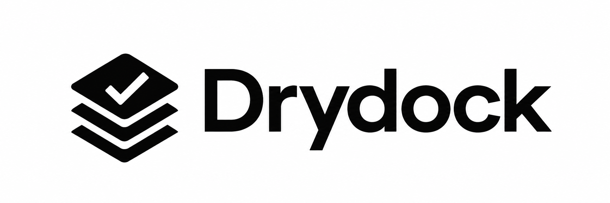

<p align="center"></p>


A crew of agents changes a codebase, and proves the result still works.

The hard part of handing work to a model is not getting it to write code. It
is knowing whether what came back is real. drydock answers that
mechanically: every change is one commit, every commit is checked by four
gates before it is allowed to stay, and anything that fails one is reverted
before the next change begins. Nothing lands on your default branch, and
nothing lands at all by being asserted.

It runs locally and drives the Claude Code CLI you are already signed in to.

**Where this is.** Being worked on, in the open, and used on real jobs while
it is built — most of what is in here was written because a run went wrong
in a way nobody could see. It is harness engineering rather than a model
project: the interesting part is not asking a model for code, it is what
the program around it does with the answer. Expect the behaviour to move.

## The problem it is built around

An agent that edits a repository can make the suite green four ways:

1. Fix the code. The only one anybody wants.
2. Change the test to match the bug.
3. Delete the test.
4. Add `@Disabled`, `skip`, `xfail`, or `return` at the top of the body.

Three of those look identical to the first in a terminal, in a diff summary,
and in a chat reply saying "all tests pass". So the suite is counted before
the work starts and counted again after, per item, and an item that leaves it
smaller is reverted. Silencers are matched in the diff directly. It is not a
prompt asking the model to behave; it is arithmetic over two numbers.

## The crew

Nine stations. Four of them can refuse, and two of those are code rather
than a model.


| Station | What it does | Can refuse |
|---|---|---|
| **Analyst** | Reads the repository and reports what is there | |
| **Architect** | Chooses the toolchain and the shape | |
| **Designer** | Decides the palette, type and composition before anything is built | |
| **Planner** | Turns it into items: as few as the work honestly needs, each one a working state | |
| **Engineer** | Writes one item. Can stop and ask the planner a question rather than guess | |
| **Verifier** | Builds it and runs the suite, and compares the test count to the baseline | ✓ code |
| **Inspector** | Reads the diff for silenced tests, weakened assertions, committed secrets, and files whose bytes do not match their extension | ✓ code |
| **Reviewer** | Reads the diff against what the item said it would do | ✓ |
| **Critic** | Renders the page in a headless browser and looks at it, at phone and desktop width | ✓ |

The Critic exists because a page can pass every test and still be wrong. It
has caught an hours table that rendered seven day names and no times: the
markup was correct, the times were near-black on a black ground, and no test
can see that.

## Two things it does that other tools do not

**It reverts.** A change that fails verification is undone before the next
one starts, so the repository is never left in a state nobody checked. Other
agents report the failure and leave the files where they are.

**It detects a weakened test.** Not "it reviews the diff" — it counts. If an
item removes a test, adds a `skip`, or turns an assertion into a tautology,
that is matched in the diff and the item goes back, whatever the suite says.

## How much it does before it starts

Not every request needs a plan, and some need one whatever they look like.
The depth is chosen before any model is called, by reading the sentence and
the repository, and it is shown and can be overruled.

| | |
|---|---|
| **Automatic** | reads the request and the repository, then picks |
| **No plan** | starts now. Build, tests and the scope check still run |
| **Plan first** | a brief, acceptance criteria, and your approval |
| **Extra careful** | more time, three attempts, work split further |

A sentence naming a migration, authentication, money or a dropped table has
a floor under it and gets a plan whatever its length, because a short
sentence about a dangerous thing reads exactly like a short sentence.

## Two that took measuring

**The Critic is given the whole page**, at two widths, not the window the
page opened in. A hero set to `100svh` used to fill both pictures, so every
page was judged by its top. Colour is resolved by the browser rather than
parsed, so `oklch()` is measured rather than guessed at — and a colour that
cannot be resolved is reported as unmeasured, because a ratio computed from
a colour nobody read is worse than no ratio.

**A refused item is thrown away**, which is what makes the rollback
affordable — but the tree is written into the object database first, so
`git show` reads it back afterwards. A site that worked, with sixteen
passing tests, was once discarded and gone because nothing had been staged.

## What a finished run leaves behind

A branch — `drydock/<run id>` — with one commit per item, and a draft pull
request whose body is the evidence rather than a summary:

- the test count before any of this, and now
- each item that landed, with its commit
- what each of the four gates said about each commit
- what was planned and did not land, and why

The diff is the description of the change. The body is the part a reviewer
cannot get from the diff.

## Running it

Needs Python 3.13, [uv](https://docs.astral.sh/uv/), and the
[Claude Code CLI](https://claude.com/claude-code) signed in. `gh` as well, if
you want pull requests opened.

```bash
uv sync
uv run drydock app          # http://127.0.0.1:8400
```

Then say what you want in plain language. There are commands — `/new`,
`/do`, `/fix`, `/ask`, `/audit`, `/migrate`, `/upgrade`, `/check` — but you
do not have to type them. What you write is routed by reading it, with a
regular expression rather than a model call.

There is a CLI that runs the same stages one at a time: `drydock --help`.

## Confinement

A worker is started with a `PreToolUse` hook that resolves the real path of
every file it touches and blocks anything outside the repository it was
given. This is not the permission list: `--allowedTools` pre-approves, it
does not restrict, and a deny pattern broad enough to cover the parent
directory also covers the repository. The hook was written after an Analyst,
given an empty folder, read drydock's own source to find something to report.

The shell goes through it too, which it did not at first: one command, no
substitution or expansion, a name on a short list, and every argument
resolved before it runs. `..` is the obvious way out and a symlink is the
boring one.

A worker also does not inherit the settings around it. Claude Code walks up
from the working directory and loads every `CLAUDE.md` it passes — a nested
`.git` does not stop it, which was measured rather than assumed — so a job
about a restaurant website was being handed this repository's instructions
to its own agent. And an API key in the shell is removed from the
environment the worker runs in.

## Skills

A skill is one Markdown file with sections addressed to individual stations,
so the planner and the engineer are handed different parts of it. They carry
what does not come from reading the repository: `greenfield`, `web-design`,
`migration`, `dependency-upgrade`. A section no station reads is reported at
load rather than dropped in silence, which is how three of them turned out
to have been going nowhere.

## Tests

```bash
uv run pytest -q
```

Two thousand-odd, and they are mostly about failures that looked like
successes: a green suite whose test count could not be read, a finished item
thrown away for want of a report, a design decision that never reached the
engineer who writes the CSS, a resumed run that quietly dropped the skills it
was working under.

## Built with

Python 3.13 · FastAPI · server-sent events · the Claude Code CLI as the
worker · git worktrees for items that can run at the same time · headless
Chrome for the Critic · no database.
